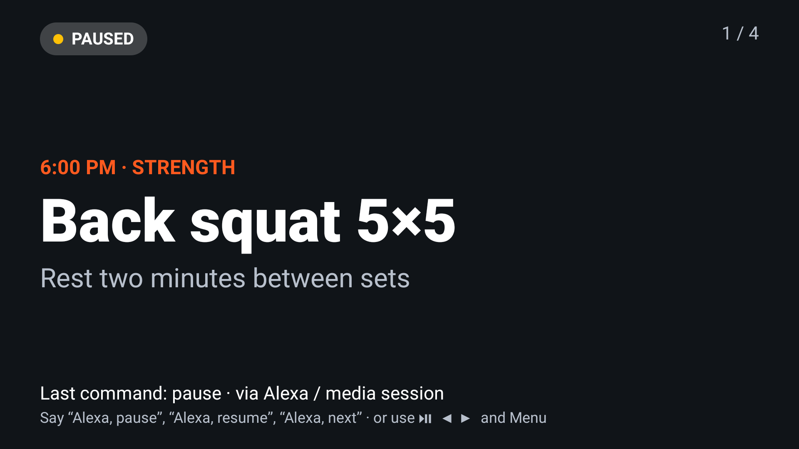
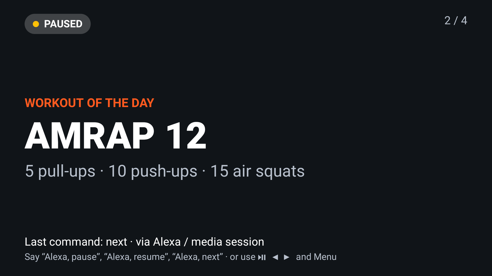
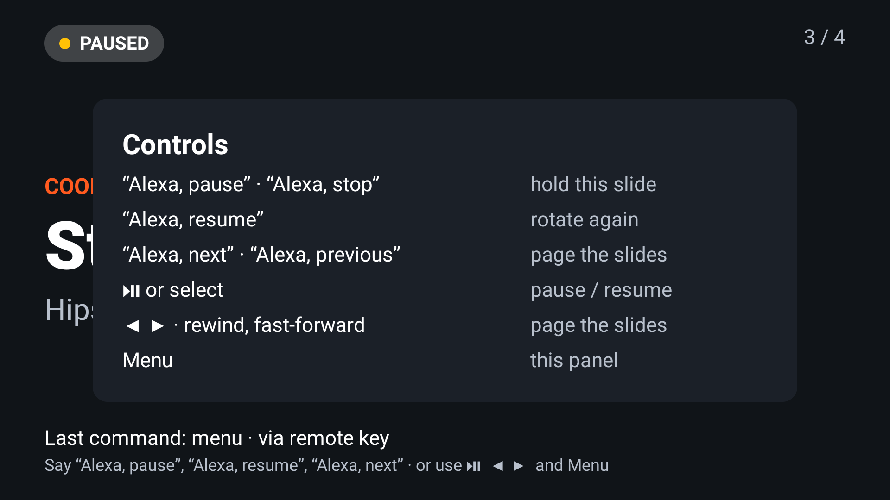

# Fire TV Voice Controls

**"Alexa, pause" and "Alexa, next" for Fire TV apps that aren't video players** (class timers, slideshows,
dashboards, menu boards, games), plus the remote's transport keys, and a way to test all of it without saying a word.

[](https://github.com/tapaderuza/firetv-voice-controls/actions/workflows/ci.yml)
[](https://jitpack.io/#tapaderuza/firetv-voice-controls)
[](LICENSE)



*The sample app on a real Fire TV Stick, after "Alexa, pause" arrived twice: the second one keeps it paused instead of
toggling it back on.*

## Why

Fire TV hands Alexa's transport commands ("Alexa, pause", "Alexa, resume", "Alexa, next"), spoken into the remote or
to a paired Echo, to the MediaSession of the app on screen
([Amazon's guide](https://developer.amazon.com/docs/fire-tv/mediasession-api-integration.html)). Every example of it
is a video player. An app that shows something else, like a gym's class timer or a café's menu board, runs into the
parts that are easy to get wrong:

- **The permission and the actions.** The app needs `com.amazon.permission.media.session.voicecommandcontrol`, an
  active session and a PlaybackState that lists each action it supports. If an action is missing, Fire OS never
  calls the app.
- **Voice says what it wants; a key toggles.** Map "Alexa, pause" to a toggle and a second "Alexa, pause" resumes
  the class. Voice and keys need different commands.
- **The remote has no Next/Previous keys,** and the D-pad and select button move focus in most UIs. A focus-less
  screen wants them; a menu does not.
- **Home pauses you.** When the user presses Home, Fire OS's key policy sends PAUSE to the session of the app
  in front, about 150 ms before `onPause`. Right for a video; wrong for a class timer shared by every TV in a gym.
  The library tells you who sent each command (`Source.SYSTEM` for this one), so you can ignore it.
- **No audio, no test.** On Fire OS 7, `adb shell media dispatch` never reaches a session that hasn't played audio,
  and `media monitor` lacks the permission, so there is no built-in way to script a voice test.

This library is the code we wrote for [ScreenDesk](https://devpost.com/software/1458275), a Fire TV class screen
for gyms built for the Amazon Developer Hackathon 2026, pulled out and generalised, with tests.

## Install

The library is published through [JitPack](https://jitpack.io/#tapaderuza/firetv-voice-controls). Add the
repository and the dependency:

```kotlin
// settings.gradle.kts
dependencyResolutionManagement {
    repositories {
        google()
        mavenCentral()
        maven("https://jitpack.io")
    }
}

// app/build.gradle.kts
dependencies {
    implementation("com.github.tapaderuza:firetv-voice-controls:v0.2.0")
}
```

There are no dependencies beyond the Android framework and the Kotlin standard library. It works on API 22+
(Fire OS 5 and later). The manifest permission is merged into your app for you.

## Use

```kotlin
class BoardActivity : ComponentActivity() {
    private lateinit var voice: VoiceControls

    override fun onCreate(savedInstanceState: Bundle?) {
        super.onCreate(savedInstanceState)
        voice = VoiceControls(
            context = this,
            listener = ::onCommand,
            keys = RemoteKeys(dpadPages = true), // Left/Right page; off by default
            adbTestHook = BuildConfig.DEBUG,
        )
        voice.update(Controls(Controls.Playback.PLAYING, canSkip = true))
    }

    private fun onCommand(command: Command, source: Source): Boolean {
        if (source == Source.SYSTEM) return true        // Fire OS pausing the app in front on Home
        when (command) {
            Command.PLAY -> board.resume()               // "Alexa, resume"
            Command.PAUSE, Command.STOP -> board.pause() // a second "Alexa, pause" keeps it paused
            Command.TOGGLE -> board.togglePause()        // the remote's Play/Pause key
            Command.NEXT -> board.next()
            Command.PREVIOUS -> board.previous()
            else -> return false                         // keys you don't handle reach the UI
        }
        voice.update(board.controls())
        return true
    }

    override fun dispatchKeyEvent(event: KeyEvent) = voice.dispatchKeyEvent(event) || super.dispatchKeyEvent(event)
    override fun onStart() { super.onStart(); voice.isActive = true }
    override fun onStop() { voice.isActive = false; super.onStop() } // never take "Alexa, pause" from another app
    override fun onDestroy() { voice.close(); super.onDestroy() }
}
```

A complete app is in [`sample/`](sample/src/main/kotlin/io/github/tapaderuza/firetv/voice/sample/MainActivity.kt):
a class board whose slides rotate on their own, pause by voice and page by voice or remote.

## What Fire OS is told

`update(controls)` turns what the screen can do into the PlaybackState Fire OS reads. Only the listed actions are
offered to Alexa.

| `Controls` | PlaybackState | Actions offered |
|---|---|---|
| `Controls.NOTHING` | `STATE_NONE` | none |
| `Controls(PLAYING)` | `STATE_PLAYING` | play, pause, play/pause, stop |
| `Controls(PAUSED, canSkip = true)` | `STATE_PAUSED` | play, pause, play/pause, stop, next, previous |
| `Controls(NONE, canSkip = true)` | `STATE_PLAYING` (the slideshow is what's playing) | next, previous |
| `Controls(PLAYING, canSeek = true)` | `STATE_PLAYING` | play, pause, play/pause, stop, fast forward, rewind |

## Remote keys

| Key | Command | When |
|---|---|---|
| Play/Pause | `TOGGLE` | always |
| Play, Pause, Stop, Next, Previous (Bluetooth remotes, keyboards) | `PLAY`, `PAUSE`, `STOP`, `NEXT`, `PREVIOUS` | always |
| Fast-forward, Rewind | `FAST_FORWARD`, `REWIND`, or `NEXT`/`PREVIOUS` with `fastForwardSkips` | always |
| Menu, Info | `MENU` | always |
| Left, Right | `PREVIOUS`, `NEXT` | `dpadPages = true` |
| Select (centre) | `TOGGLE` | `selectToggles = true` |
| Back, Home, Up, Down | never taken | |

A key fires once when pressed. Its repeats and its release are consumed only if the app handled the press, so a held
Right pages once, and a key your listener declines still reaches the UI.

## Test it without speaking

| What | How | Where |
|---|---|---|
| Mapping logic: state → actions, key → command, held keys, who called | `./gradlew :voicecontrols:testDebugUnitTest` (15 tests) | JVM |
| The session, driven through the system's media session service as Fire OS's voice service does, and Fire OS's own pause on Home | `./gradlew :voicecontrols:connectedDebugAndroidTest` (8 tests) | a Fire TV |
| Your own app by "voice" | build with `adbTestHook = BuildConfig.DEBUG`, then `scripts/alexa.sh pause com.your.app` | a Fire TV |
| The sample, end to end, with a screenshot after each step | `scripts/device-check.sh` | a Fire TV |

`scripts/alexa.sh` sends a broadcast that the hook turns into `MediaController.transportControls.pause()` (or play,
stop, next, previous, fastforward, rewind). `adb logcat -s FireTvVoice` shows every command the session delivers.

<table><tr>
<td></td>
<td></td>
</tr><tr>
<td><code>scripts/alexa.sh next</code></td>
<td><code>adb shell input keyevent KEYCODE_MENU</code></td>
</tr></table>

## Verified on

| Device | Fire OS | Unit tests | On-device tests | `device-check.sh` |
|---|---|---|---|---|
| Fire TV Stick (3rd gen, AFTSSS) | 7.7.1.7 (Android 9, API 28) | 15/15 | 8/8 | pass |

The on-device tests and the adb hook use a MediaController, which goes through the same system service as Fire
OS's voice service. A spoken "Alexa" command needs a person and a microphone, so it isn't part of the automated
checks. Reports from other devices (Fire OS 8, Fire TV Cube, Omni) are very welcome.

## Who sent it

Every command comes with its `Source`:

| `Source` | Sent by | Typical handling |
|---|---|---|
| `MEDIA_SESSION` | Alexa (remote mic or Echo), the Fire TV mobile app, Bluetooth controls, the adb hook | act on it |
| `SYSTEM` | Fire OS itself (uid 1000), e.g. the PAUSE it sends when the user presses Home | a video pauses; a shared screen ignores it |
| `REMOTE_KEY` | a key on the remote, through `dispatchKeyEvent` | act on it; return false to leave it to the UI |

The caller is known on API 28+ (Fire OS 7 and later). `adb logcat -s FireTvVoice` prints the caller's package
and uid next to every command.

## Notes

- Commands reach your listener on the main thread. Create `VoiceControls` on the main thread too.
- Call `update` on every change of what the screen can do. It is cheap, and a stale state is how "Alexa, next"
  ends up offered on a screen with one slide.
- `STOP` is separate from `PAUSE` so a video player can tell them apart. A screen on a wall usually treats both
  as pause.
- Not covered yet: "Alexa, fast forward 30 seconds" arrives as a seek to an absolute position, which needs the app
  to report its position. Vega OS apps use a different API.

## License

[Apache 2.0](LICENSE)
